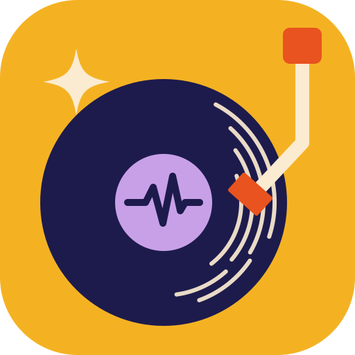

<p align="center">
  
</p>

<h1 align="center">Record Player</h1>

<p align="center"><strong>Every chart has a soundtrack.</strong></p>

<p align="center">
  <em>Internal app · Built by Abstractive Health · Free · Open source (MIT)</em>
</p>

Record Player is a small [SMART on FHIR](https://docs.smarthealthit.org/) app from
[Abstractive Health](https://www.abstractivehealth.com). Opened from a patient's chart in the
Abstractive App Marketplace, it reads the patient's **AI medical record summary**, picks a song
that fits the chart, and plays it in the browser. The interface shows the song and has play/pause
and volume. That's all.

It also runs out of the box in the [SMART App Launcher](https://launch.smarthealthit.org) sandbox
used by the [SMART App Gallery](https://apps.smarthealthit.org), so anyone can try it with synthetic
patients. See [Try it in the SMART sandbox](#try-it-in-the-smart-sandbox).

It's deliberately simple, and it's **open source so anyone can copy it as a starting point** for
their own SMART on FHIR app on Abstractive. It shows the parts every app needs: the SMART launch,
a scoped FHIR read, and a design where patient data never leaves the browser. Swap the music for
your own idea.

- **Frontend only.** No backend, no database, no server code. It's static files.
- **No accounts, no profiles, no billing.** It's a free internal app.
- **Doesn't save patient data.** The summary is read into memory, turned into a song choice, and
  dropped. Nothing about the patient is stored or sent anywhere.

## How it works

```
Abstractive chart ──launch──▶ Record Player ──SMART authorize (PKCE)──▶ Abstractive
                                   │
                                   ├─ GET DocumentReference?patient=…&category=…|ai-summary
                                   ├─ GET Binary/<id>        (the summary text, Markdown)
                                   │
                                   ├─ in the browser: summary ─▶ themes + mood ─▶ one track
                                   │                 (from the bundled 1,000-track catalog)
                                   └─ ▶ plays the track's openly licensed audio
```

1. **Launch.** A clinician opens Record Player from the chart. Abstractive opens
   `https://record-player.abstractive.ai/?iss=<FHIR base>&launch=<token>`.
2. **Authorize.** [`fhirclient`](https://docs.smarthealthit.org/client-js/) runs the SMART EHR
   launch as a _public client_: PKCE S256, no client secret (a browser can't keep one). The app
   only accepts Abstractive's FHIR servers and the SMART App Launcher sandbox as `iss`.
3. **Read the summary.** Abstractive publishes the AI summary like any other document: a
   `DocumentReference` whose attachment points at a `Binary`. Its category is
   `https://abstractivehealth.com/fhir/CodeSystem/document-category|ai-summary`. The app asks
   for that one document and reads its text.
4. **Pick a song, in the browser.** See below.
5. **Play.** Only when the user presses play does the browser fetch the track's audio from its
   fixed catalog URL.

### SMART details

|                             |                                                                                 |
| --------------------------- | ------------------------------------------------------------------------------- |
| Client id                   | `abstractive-record-player` (public client, `token_endpoint_auth_method: none`) |
| Launch URL / redirect URI   | `https://record-player.abstractive.ai/`                                         |
| Scopes on Abstractive       | `launch patient/DocumentReference.read patient/Binary.read`                     |
| Scopes in the SMART sandbox | the above plus `patient/Patient.read patient/Condition.read`                    |
| Not requested               | `openid`, `fhirUser` (no user profile), `offline_access` (no refresh tokens)    |
| FHIR servers accepted       | `VITE_ABSTRACTIVE_ISS` and `VITE_SANDBOX_ISS` in [`.env`](.env)                 |

## Privacy by design

The app is built so that patient information stays in the clinician's browser tab.

- **What it reads:** only the launch patient's AI summary document, with read-only scopes. (In
  the SMART sandbox, which has no AI summary, it reads the synthetic patient's age and problem
  list instead.)
- **Where it lives:** in JavaScript memory while the song is picked (`src/App.jsx`,
  `chooseSong`). Only the chosen track is kept. It's never written to storage, never logged,
  never put in a URL.
- **What the browser stores:** fhirclient keeps the SMART session (access token, the opaque
  patient id) in this tab's `sessionStorage`, which the browser clears when the tab closes. There
  are no cookies, no `localStorage`, no analytics.
- **What leaves the browser:** requests to the Abstractive FHIR server (to read the summary), and
  one request for the chosen song's audio file. That request is a fixed URL from the catalog with
  no search terms and no referrer (`Referrer-Policy: no-referrer`).
- **Enforced by the browser:** a strict Content Security Policy ([`public/_headers`](public/_headers))
  allows scripts only from this site, network calls only to Abstractive's FHIR servers (and the
  SMART sandbox), and audio only from the catalog's host. Only Abstractive (and the SMART sandbox)
  can frame the app.

## How the song is chosen

Everything happens in [`src/music/`](src/music), with no network calls:

1. **Listen for themes** ([`lexicon.js`](src/music/lexicon.js)). Twelve clinical themes, each with
   the terms that signal it, song-title keywords and genres. For example, cardiac terms like
   _atrial fibrillation_ or _hypertension_ point to titles with _heart_, _beat_ or _rhythm_.
   Respiratory terms point to _breath_, _air_ and _wind_, and diabetes to _sugar_ and _sweet_.
   Negated mentions ("no history of cancer") are ignored.
2. **Set the mood** ([`features.js`](src/music/features.js)). The themes' moods blend into a
   target _energy_ (calm to driving) and _valence_ (somber to bright). High-acuity words (ICU,
   sepsis, hospice) make it gentler, and improving or worsening trajectories nudge it brighter or
   softer. The patient's age, if the summary states it, nudges genres (jazz and classical for older
   patients, pop and electronic for younger ones).
3. **Score the catalog** ([`pick.js`](src/music/pick.js)). Each of the ~1,000 tracks is scored
   on mood closeness, theme keywords in its title and tags, and genre fit.
4. **Draw from the shortlist.** A seeded, weighted pick from the top 25. The seed is a hash of the
   summary and today's date, so a chart keeps its song for the day and gets a new one tomorrow,
   and two similar charts still get different songs.

If a chart has no AI summary yet, the app plays an easygoing pick. On other SMART
servers (the SMART sandbox), it builds the same kind of text from the patient's age and problem list
(`fetchProblemListText` in [`src/smart/summary.js`](src/smart/summary.js)) and picks from that.

## The music catalog

[`src/catalog/tracks.json`](src/catalog/tracks.json) holds about 1,000 full-length tracks from
[Jamendo](https://www.jamendo.com), found through the [Openverse](https://openverse.org) API and
limited to **CC0, Public Domain Mark, CC BY and CC BY-SA**. The app shows each track's title,
artist, license and source link while it plays, and [`ATTRIBUTIONS.md`](ATTRIBUTIONS.md) lists
them all. Audio streams from Jamendo; the files aren't copied into this repository, which would make
it several gigabytes.

The catalog is built by [`scripts/build-catalog.mjs`](scripts/build-catalog.mjs). It uses about 80
genre, mood and theme searches, filters out explicit material and titles that would feel wrong next
to a chart, keeps at most three tracks per artist, and checks that every audio URL plays. It needs no
API key and stays inside Openverse's anonymous limits (20 requests a minute, 200 a day).

```bash
npm run build:catalog
```

```bash
npm run verify:catalog
```

The first command rebuilds the catalog (about 10 minutes). The second re-checks that every
committed track still plays. You can also run the **Refresh music catalog** GitHub Action, which
attaches the new files for a reviewed PR.

## Run it locally

Requires Node 22.

```bash
npm ci
```

```bash
npm run dev
```

To see the whole Abstractive launch locally, with synthetic patients and AI summaries:

```bash
npm run demo
```

Then open http://localhost:9090/ and pick a patient. It runs the app against
[`e2e/mock-abstractive.mjs`](e2e/mock-abstractive.mjs), a small stand-in for Abstractive's SMART
server and FHIR API. To use the real SMART sandbox instead, start `npm run dev` and launch
`http://localhost:5173/` from the [SMART App Launcher](https://launch.smarthealthit.org).

```bash
npm test
```

```bash
npm run lint
```

```bash
npm run build
```

`npm test` runs the unit tests (Vitest), `npm run lint` runs ESLint and Prettier, and
`npm run build` writes the static site to `dist/`.

## Try it in the SMART sandbox

No Abstractive account needed. Open the
[SMART App Launcher with Record Player](https://launch.smarthealthit.org/?launch_url=https%3A%2F%2Frecord-player.abstractive.ai%2F&launch=WzAsIiIsIiIsIkFVVE8iLDEsMSwwLCIiLCIiLCIiLCIiLCIiLCIiLCIiLDAsMSwiIl0),
choose a patient and press **Launch**. Or set it up yourself: Launch Type _Provider EHR Launch_,
FHIR version _R4_, App's Launch URL `https://record-player.abstractive.ai/`. The client id and
redirect URI can be left as they are; the sandbox accepts any.

The sandbox's synthetic patients have no Abstractive AI summary, so the app picks the song from the
patient's age and problem list. Details for the
[SMART App Gallery](https://apps.smarthealthit.org) listing are in
[docs/smart-app-gallery.md](docs/smart-app-gallery.md).

## Build your own app on Abstractive

Fork this repository and keep what's generic:

1. **Rename it.** Change `VITE_SMART_CLIENT_ID` in `.env`, the name in `package.json` and
   `index.html`, and the icon in `public/`.
2. **Choose your scopes** in [`src/config.js`](src/config.js). Ask for the least you need.
3. **Replace the idea.** `src/smart/summary.js` shows how to read the AI summary. Replace
   `src/music/` and `src/player/` with your own logic and UI.
4. **Host it anywhere static.** For example Cloudflare Pages, Netlify, GitHub Pages or S3. Copy
   [`public/_headers`](public/_headers) (or its equivalent) and adjust the CSP.
5. **Register with Abstractive.** Send Abstractive your client id, launch URL, redirect URI and
   scopes. Browser-only apps are registered as public clients (PKCE, no secret). Abstractive then
   lists the app in the App Marketplace.

## Deployment

`main` deploys to **https://record-player.abstractive.ai** on Cloudflare Pages through
[`.github/workflows/deploy.yml`](.github/workflows/deploy.yml). It runs in the `production`
environment, which holds `CLOUDFLARE_API_TOKEN` (Cloudflare Pages: Edit only) and
`CLOUDFLARE_ACCOUNT_ID`. The Pages project, custom domain and DNS record are managed in
Abstractive's infrastructure repository.

## Contributing and governance

Contributions are welcome. See [CONTRIBUTING.md](CONTRIBUTING.md). Anyone can open a pull request,
but for now **only Abstractive Health employees can merge to `main`**. That's enforced by
repository permissions and the ruleset in [`.github/rulesets/main.json`](.github/rulesets/main.json):
pull requests only, an approving code-owner review, passing CI, and no force-pushes or deletion.
Report security issues as described in [SECURITY.md](SECURITY.md).

## License

[MIT](LICENSE) © Abstractive Health. The music is not covered by this license: each track keeps its
own Creative Commons or public-domain terms (see [ATTRIBUTIONS.md](ATTRIBUTIONS.md)).
