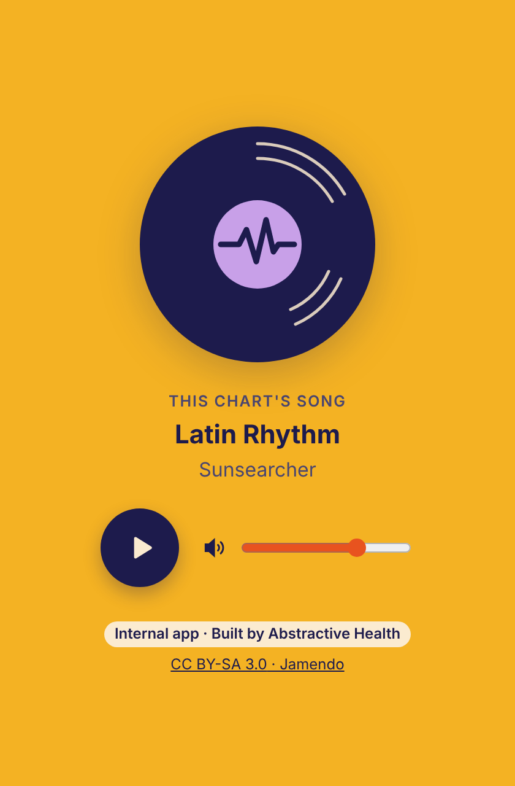
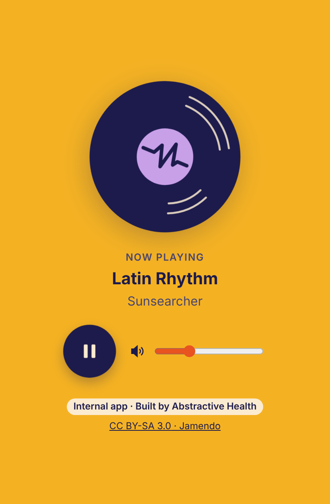
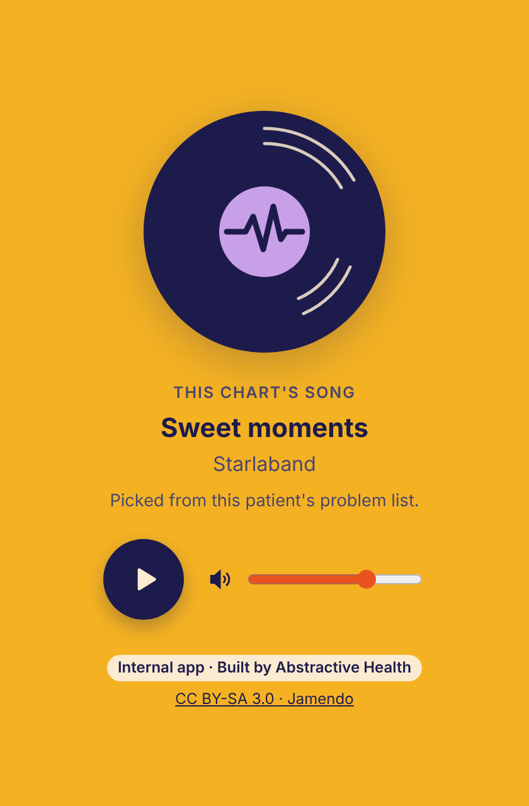

# SMART App Gallery listing

Everything needed to submit Record Player to the [SMART App Gallery](https://apps.smarthealthit.org),
ready to paste into the submission form. Reviewers can try it in the SMART App Launcher sandbox
with synthetic patients; it needs no Abstractive account.

## Listing

| Field                | Value                                                                                                   |
| -------------------- | ------------------------------------------------------------------------------------------------------- |
| App name             | Record Player                                                                                           |
| Tagline              | Every chart has a soundtrack.                                                                           |
| Organization         | Abstractive Health                                                                                      |
| Website              | https://github.com/Abstractive-Health/abstractive-record-player                                         |
| Support              | https://github.com/Abstractive-Health/abstractive-record-player/issues                                  |
| Price                | Free                                                                                                    |
| License              | Open source, MIT                                                                                        |
| Audience             | Clinicians (provider-facing EHR launch)                                                                 |
| Category             | Clinician engagement / sample and developer tools                                                       |
| Specialties          | All                                                                                                     |
| FHIR version         | R4                                                                                                      |
| SMART version        | SMART App Launch with v1 scopes (`patient/*.read`), EHR launch, public client with PKCE S256            |
| Launch URL           | https://record-player.abstractive.ai/                                                                   |
| Redirect URI         | https://record-player.abstractive.ai/                                                                   |
| Scopes (sandbox)     | `launch patient/DocumentReference.read patient/Binary.read patient/Patient.read patient/Condition.read` |
| Scopes (Abstractive) | `launch patient/DocumentReference.read patient/Binary.read`                                             |
| Data stored          | None. No backend, no accounts, no cookies, no analytics.                                                |
| Icon                 | [`public/icon.svg`](../public/icon.svg) (512×512 PNG: [`public/icon-512.png`](../public/icon-512.png))  |
| Screenshots          | [`docs/screenshots/`](screenshots/)                                                                     |
| Try it               | [Open in the SMART App Launcher][try]                                                                   |

[try]: https://launch.smarthealthit.org/?launch_url=https%3A%2F%2Frecord-player.abstractive.ai%2F&launch=WzAsIiIsIiIsIkFVVE8iLDEsMSwwLCIiLCIiLCIiLCIiLCIiLCIiLCIiLDAsMSwiIl0

## Short description

A free, open-source sample SMART on FHIR app from Abstractive Health that turns a patient's chart
into a song: it reads the chart in the browser, picks a fitting, openly licensed track, and plays it.

## Description

Record Player is a deliberately small SMART on FHIR app from Abstractive Health, published as open
source (MIT) so developers can copy it as a starting point for their own apps. Launched from a
patient's chart, it reads the record in the browser, matches it to one of about 1,000 openly licensed
tracks, and plays it. It looks for clinical themes such as cardiac, respiratory, sleep, mobility and
metabolic, and considers mood, acuity and age. The interface is just the song, play/pause and volume.

On Abstractive Health it reads the patient's AI medical record summary. In the SMART sandbox and
other FHIR servers, it uses the patient's age and problem list (Patient, Condition) instead.

It is frontend-only: no backend, no database, no user accounts, no billing, and no patient data
stored or sent anywhere. The chart is read into memory, turned into a song choice, and dropped.
The only other request is for the chosen track's audio, from a fixed catalog URL. A strict Content
Security Policy enforces this. Music is from Jamendo under CC0, CC BY and CC BY-SA, with attribution
shown while it plays.

## How reviewers can test it

1. Open the [SMART App Launcher with Record Player][try]. Or set it up by hand: Launch Type
   _Provider EHR Launch_, FHIR version _R4_, App's Launch URL `https://record-player.abstractive.ai/`.
2. Pick any patient and press **Launch**.
3. Record Player shows the patient's song, "Picked from this patient's problem list."
   Press play, adjust the volume, and pause.
4. Launch other patients: each gets a different song, and the same patient keeps the same song for
   the day.

## Screenshots

| Ready to play                   | Playing                             | SMART sandbox launch                              |
| ------------------------------- | ----------------------------------- | ------------------------------------------------- |
|  |  |  |

The screenshots use synthetic patients only.
